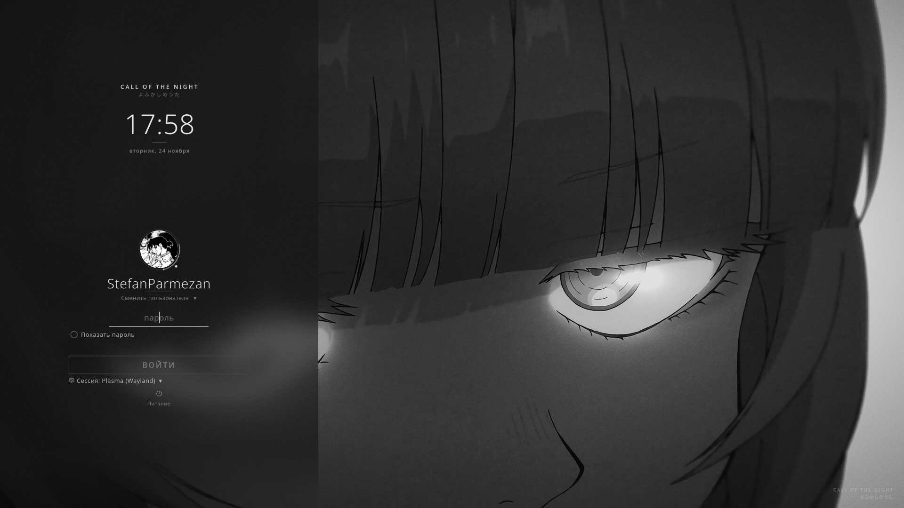
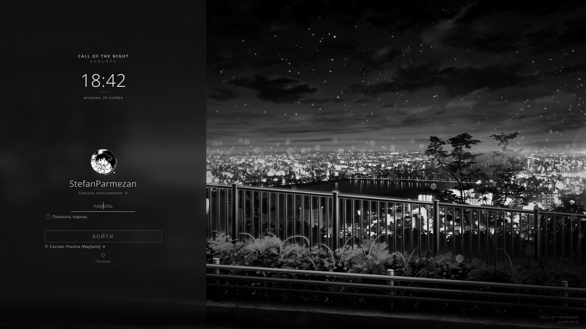
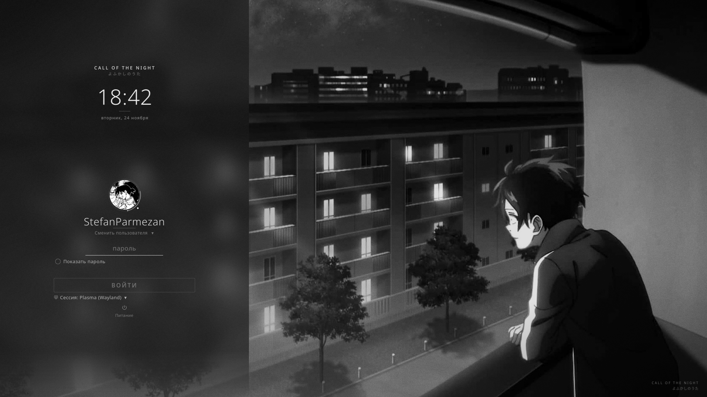
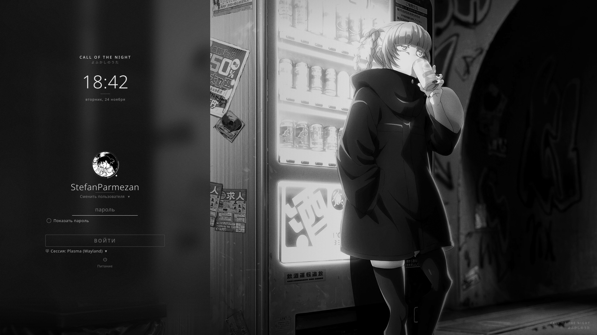

# Call of the Night — SDDM Theme


A calm, monochrome SDDM login screen inspired by
[Makima-SDDM](https://github.com/Arnau029/Makima-SDDM) and
[SDDM Sugar Candy](https://github.com/MarianArlt/sddm-sugar-dark).
Graphite palette, soft motion, a frosted panel on the left and a static
black-and-white frame from **Call of the Night** (*Yofukashi no Uta*).

<p align="center">
  
</p>

## Screenshots

| Power menu | Night city |
| --- | --- |
|  |  |

| Ko Yamori | Nazuna at the vending machine |
| --- | --- |
|  |  |

## Features

- Monochrome palette: `#e8e8e8` / `#cfcfcf` / `#111111`.
- Static background by default — **Nazuna's eyes** — with soft blur on the left
  and a clear, sharp image on the right.
- Large circular avatar (AccountsService first, initials as a fallback),
  a slowly rotating orbit ring and the full user name without a frame.
- User menu with avatars, real names and login names.
- Borderless name and password fields with an animated underline on hover/focus.
- Show-password checkmark, Caps Lock and Num Lock indicators.
- Session selector with Wayland/X11/generic icons and a checkmark for the
  current session.
- Compact power button and a small menu for suspend/hibernate/reboot/shutdown.
- Soft intro, user/session crossfades, failed-login shake and a gentle login
  fade-out. All of it can be disabled with one option.
- Keyboard focus rings, a clear Tab order and accessibility names.
- Everything UI-related is configurable in [`theme.conf`](theme.conf).

Tested with **SDDM 0.21 / Qt 6 / KDE Plasma 6** on Debian.

## Requirements

Qt 6:

```bash
# Debian / Ubuntu
sudo apt install sddm qml6-module-qtquick qml6-module-qtquick-controls \
    qml6-module-qtquick-layouts qml6-module-qt5compat-graphicaleffects \
    fonts-noto-core fonts-noto-cjk

# Arch Linux
sudo pacman -S sddm qt6-declarative qt6-5compat noto-fonts noto-fonts-cjk
```

The theme uses `Qt5Compat.GraphicalEffects` for the blur, shadows and masks.
On Debian the package is `qml6-module-qt5compat-graphicaleffects`, on Arch it is
part of `qt6-5compat`.

## Installation

### Automatic

```bash
cd CallOfTheNight-SDDM
sudo ./install.sh
```

The script copies the theme to `/usr/share/sddm/themes/CallOfTheNight-SDDM`
and creates `/etc/sddm.conf.d/10-callofthenight.conf`.

### Manual

```bash
sudo cp -r CallOfTheNight-SDDM /usr/share/sddm/themes/
sudo mkdir -p /etc/sddm.conf.d
```

Create `/etc/sddm.conf.d/10-callofthenight.conf`:

```ini
[Theme]
Current=CallOfTheNight-SDDM
```

### Test without logging out

```bash
sddm-greeter-qt6 --test-mode --theme /usr/share/sddm/themes/CallOfTheNight-SDDM
```

Or directly from the project directory:

```bash
sddm-greeter-qt6 --test-mode --theme "$PWD"
```

Apply the theme with a reboot or:

```bash
sudo systemctl restart sddm
```

This command ends the current graphical session.

### Uninstall

```bash
sudo rm -rf /usr/share/sddm/themes/CallOfTheNight-SDDM
sudo rm -f /etc/sddm.conf.d/10-callofthenight.conf
```

## Configuration

All options live in [`theme.conf`](theme.conf) and have English comments.

| Option | Description |
| --- | --- |
| `Background` | Fixed background path, relative to the theme root |
| `DimBackgroundImage` | Background dimming, `0.0`–`1.0` |
| `FullBlur` / `PartialBlur` / `BlurRadius` | Blur mode and strength |
| `BlurPanelWidth` | Blurred panel width as a fraction of the form width, `0.7`–`1.0` |
| `BlurFadeWidth` | Width of the soft fade on the right, in font-size multiples |
| `FormPanelOpacity` | Opacity of the dark panel behind the form |
| `HaveFormBackground` | Translucent panel behind the form |
| `FormPosition` | `left`, `center` or `right` |
| `MainColor` / `AccentColor` / `BackgroundColor` | Text, focus and panel colors |
| `RoundCorners` | Corner radius in pixels (`0` for sharp corners) |
| `ScreenWidth` / `ScreenHeight` | Fixed resolution; empty means auto |
| `HeaderText` / `HeaderSubtext` | Title and subtitle above the clock |
| `AnimationsEnabled` | `false` disables intro, crossfade, orbit, shake and login fade |
| `ForceHideSystemButtons` | Hide the power button |
| `TranslatePower` | Label for the power button |
| `Locale` | Date/time locale, e.g. `en_US` or `ru_RU` |
| `HourFormat` / `DateFormat` | Clock and date formats |

### English UI

The theme ships with Russian UI labels. An English preset:

```ini
Locale="en_US"
DateFormat="dddd, d MMMM"

TranslateChangeUser="Change user"
TranslatePlaceholderUsername="username"
TranslatePlaceholderPassword="password"
TranslateShowPassword="Show password"
TranslateLogin="Sign in"
TranslateLoginFailedWarning="Incorrect username or password"
TranslateSession="Session:"
TranslatePower="Power"
TranslateSuspend="Suspend"
TranslateHibernate="Hibernate"
TranslateReboot="Reboot"
TranslateShutdown="Shut down"
TranslateVirtualKeyboardButton="Keyboard"
```

Then `sudo systemctl restart sddm`.

## Backgrounds

The default is `Backgrounds/background-eyes.png` — a close-up of Nazuna's eyes.
The background is static: no random rotation and no Ken Burns.

| File | Description |
| --- | --- |
| `background-eyes.png` | Nazuna's eyes (default) |
| `background-city.png` | Night city, no characters |
| `background-yamori.png` | Ko Yamori on the balcony |
| `background.png` | Nazuna by the vending machine |
| `background-manga.png` | High-contrast manga panel |

Switch backgrounds by editing one line:

```ini
Background="Backgrounds/background-city.png"
```

If the configured file is missing, the theme automatically falls back to
`background-eyes.png`.

## User profile

The avatar is loaded from AccountsService
(`/var/lib/AccountsService/icons/<user>`), the same source Plasma uses.
If it is unavailable, the theme shows the user's initials. The Debian
`~/.face` placeholder is intentionally ignored.

The large name is the user's **real name** (`StefanParmezan`), while SDDM
authenticates with the system login (`stefanparmezan`). Click the avatar or
"Change user" to open the user menu; the selected user resets the password.

## Power menu

The power button is always visible (unless `ForceHideSystemButtons="true"`).
Its menu contains sleep, hibernate, reboot and shut down. Unsupported actions
are softly dimmed but remain visible; `--test-mode` may not execute them
because SDDM does not expose power actions to the test greeter.

## Animations

`AnimationsEnabled="true"` keeps the subtle motion:

- intro fade/slide for the whole form and a delayed profile fade;
- crossfade when switching users or sessions;
- very slow orbit rotation around the avatar (one revolution per 2 minutes);
- failed-login shake and login fade-out.

Set it to `"false"` for a completely static login screen. Short hover
transitions on fields and buttons remain.

## Troubleshooting

### SDDM shows a white or broken screen

The theme must be marked as Qt 6 in `metadata.desktop`:

```bash
grep QtVersion /usr/share/sddm/themes/CallOfTheNight-SDDM/metadata.desktop
```

It must print `QtVersion=6`. Without it, SDDM 0.21 on Qt 6 tries to launch the
missing `/usr/bin/sddm-greeter` and falls back to the embedded theme, which can
look white/broken.

Check the greeter log:

```bash
sudo journalctl -u sddm -b --no-pager | grep -iE 'requires missing|fallback|theme at'
```

Reinstall the theme and restart SDDM if the installed metadata is stale.

### Power actions do not work in test mode

`--test-mode` runs the greeter without the SDDM daemon, so suspend, hibernate,
reboot and shutdown may be unavailable. Test them in a real SDDM session.

### IBus Wayland notification

An IBus notification about `QT_IM_MODULE` / `GTK_IM_MODULE` comes from the
desktop session input-method configuration, not from this theme. In KDE, set
**System Settings → Input Devices → Virtual Keyboard** to **None** or
**IBus Wayland**; do not export those variables manually under Wayland.

## Qt 5

The theme targets Qt 6. On Qt 5.15 replace the effects import in
`Main.qml`, `Components/Input.qml`, `Components/SessionButton.qml`,
`Components/SystemButtons.qml` and `Components/UserAvatar.qml`:

```qml
// from
import Qt5Compat.GraphicalEffects

// to
import QtGraphicalEffects 1.0
```

If your Qt 5 build requires it, restore the Virtual Keyboard import version:

```qml
import QtQuick.VirtualKeyboard 2.3
```

## Project structure

```text
CallOfTheNight-SDDM/
├── Assets/            # SVG icons and the noise texture
├── Backgrounds/       # black-and-white backgrounds
├── Components/        # form, clock, profile, menus and power controls
├── Previews/          # screenshots used by this README
├── preview.png        # screenshot shown in the SDDM theme list
├── Main.qml
├── metadata.desktop
├── theme.conf
├── install.sh
└── LICENSE
```

## Credits & license

- Code based on **SDDM Sugar Candy** © 2018–2020 Marian Arlt.
- Layout and idea inspired by **Makima-SDDM** © Arnau029.
- Anime and characters © **Kotoyama / Shogakukan / Liden Films**.
  Backgrounds are used in a non-commercial fan theme; all rights belong to
  their respective owners.
- Background sources: Wallhaven (`oxowr5`, `1p92yg`, `1q1ovv`, `gw7qyd`) and
  wallpapers.com (Ko Yamori frame). All were converted to grayscale, mirrored
  where needed and finished with subtle grain and vignette.

Code is licensed under **GPL-3.0-or-later**. See [LICENSE](LICENSE).
